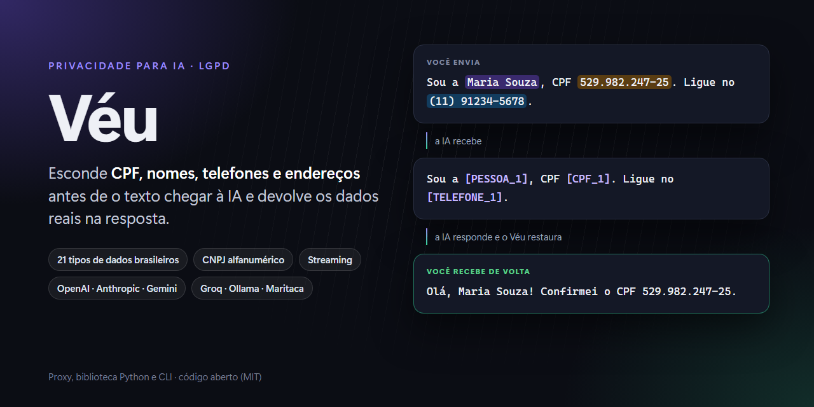
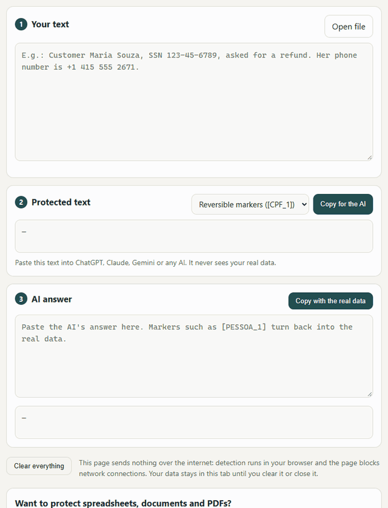

<p align="center">
  
</p>

<p align="center">
  <a href="https://github.com/guhttps/veu/actions/workflows/ci.yml"></a>
  <a href="https://pypi.org/project/veu/"></a>
  <a href="https://www.npmjs.com/package/@guhttps/veu"></a>
  
  <a href="LICENSE"></a>
</p>

[Português](README.md) · **English**

# Véu

**Véu hides personal data and secrets before your text reaches an AI model, and puts the real data back in the answer.** The model works with `[PESSOA_1]`, `[EMAIL_1]` and `[CHAVE_API_1]`; you see the real values.

```text
You send        I'm Maria Souza (maria@example.com), CPF 529.982.247-25. Use the key sk-proj-4f9a...
The AI gets     I'm [PESSOA_1] ([EMAIL_1]), CPF [CPF_1]. Use the key [CHAVE_API_1]
The AI answers  Done, [PESSOA_1]! I set [CHAVE_API_1] in your .env.
You get         Done, Maria Souza! I set sk-proj-4f9a... in your .env.
```

<p align="center"></p>

**Try it without installing anything:** [guhttps.github.io/veu](https://guhttps.github.io/veu/?lang=en). The page is in English when your browser is, everything runs in your browser, and nothing is sent anywhere.

> [!NOTE]
> Véu was born in Brazil. Brazilian documents have the deepest support (CPF, CNPJ, RG, CNH and more, validated by their check digits), and the interface, CLI commands, config keys and most of the documentation are in Portuguese. E-mails, international phone numbers, cards, IBAN, IP addresses and secrets work in text from anywhere, and documents from 21 other countries are recognized too: Portugal, nine Latin American countries, Angola, Mozambique, the US (SSN, ITIN, Medicare), Spain, Italy, France, Germany, the UK, the Netherlands, Canada and India, plus passport MRZ lines, VINs and Bitcoin and Ethereum addresses.

> [!IMPORTANT]
> No automatic detection is perfect. Véu greatly **reduces** the risk of sending personal data to an AI, but does not remove it. See the [benchmark](#benchmark) and the [limitations](SECURITY.md).

## What makes it different

- **Reversible, also in streaming.** Each value gets a marker (`[CPF_1]`), the same value always gets the same marker, and the answer is restored as it streams, even when a marker is split across chunks.
- **Restoration is a policy, not a prompt.** Since the model only ever sees markers, a real value can only reappear through Véu's restoration, so that step is where Véu enforces the rules. Real data is never restored inside links, images, URLs or HTML attributes (the EchoLeak/GitLab Duo exfiltration pattern). API keys and passwords are not restored into agent tool calls by default. Marker-looking strings that arrive from third parties are defused before sending.
- **Validated, not guessed.** Documents are checked with their check digits (CPF, CNPJ, IBAN, cards, SSN ranges, Aadhaar's Verhoeff, passport MRZ...), so `max_tokens: 2048` does not become a secret and any 11-digit number does not become a CPF.
- **Measured on other people's data.** Leakage is measured on two public Portuguese datasets written by other teams and on a frozen hand-written challenge set, with 95% confidence intervals, and compared with Microsoft Presidio on the same texts.
- **The same detection everywhere.** Python and TypeScript libraries give identical results (a 300-case conformance test enforces it), so the browser, the extension and the server agree.
- **Light.** The core has zero dependencies and processes about 330k characters per second. An optional BERT model (`veu[ml]`) catches more names when speed matters less.

## Quick start

| You want to... | Use |
|---|---|
| paste text into ChatGPT, Claude or Gemini without exposing data | The [web page](https://guhttps.github.io/veu/) or the browser extension (Chrome, Edge, Firefox) |
| protect an app that calls an AI API, in any language | The proxy: `pip install "veu[servidor]"`, `veu servir`, then point your SDK's base URL to `http://127.0.0.1:8787/v1` |
| protect Python code | `pip install veu`, then `openai_client()`, `anthropic_client()`, LangChain or `@protect` |
| protect JavaScript or TypeScript code | `npm install @guhttps/veu`, then `createFetch()` or the Vercel AI SDK middleware |
| protect Claude Code, Codex CLI or Cursor | The Claude Code plugin and hooks (they also block `cat .env` and `printenv`), or the proxy |
| protect a whole company | The central gateway (teams, OIDC single sign-on, tamper-evident audit log with SIEM export, encrypted Redis vault, Helm chart), the LiteLLM guardrail or the managed extension |
| automate WhatsApp support in n8n | The `@guhttps/n8n-nodes-veu` community node |

### Proxy

```bash
pip install "veu[servidor]"
veu servir            # http://127.0.0.1:8787
```

```python
from openai import OpenAI

client = OpenAI(base_url="http://127.0.0.1:8787/v1")            # OpenAI
groq = OpenAI(base_url="http://127.0.0.1:8787/groq/v1")         # Groq, OpenRouter, Ollama and 20 other providers
```

Anthropic, Gemini and Ollama formats are supported too, including streaming and tool calls.

### Library

```python
import veu

result = veu.anonymize("Hi, I'm João da Silva, CPF 529.982.247-25, phone (11) 91234-5678.")
result.text
# "Hi, I'm [PESSOA_1], CPF [CPF_1], phone [TELEFONE_1]."
veu.restore("Sure, [PESSOA_1]. I'll call [TELEFONE_1].", result.vault)
# "Sure, João da Silva. I'll call (11) 91234-5678."
```

```ts
import OpenAI from "openai";
import { createFetch } from "@guhttps/veu/fetch";

const client = new OpenAI({ fetch: createFetch() });   // same for Anthropic
```

### Files and sources

```bash
veu anonimizar clients.xlsx -o clients-protected.xlsx --cofre vault.json   # keeps formatting and formulas
veu restaurar answer.docx --cofre vault.json -o final.docx
veu ler https://docs.google.com/spreadsheets/d/.../edit                       # Notion and Google, read protected
veu demonstrar                                                               # what would leak with and without Véu
```

Commands are in Portuguese: `anonimizar` (anonymize), `restaurar` (restore), `ler` (read), `servir` (serve), `avaliar` (evaluate), `painel` (local dashboard).

## What is detected

| Kind | Examples |
|---|---|
| People and contacts | names (IBGE 2022 census lists, capitalization and context), e-mails, phones (Brazilian and international), addresses, dates of birth |
| Brazilian documents | CPF, CNPJ (including the 2026 alphanumeric format), RG, CNH, voter ID, PIS, SUS card, passport, CEP, license plates, RENAVAM, lawsuit numbers, bank accounts, Pix keys |
| Other countries | Portugal, Argentina, Mexico, Chile, Uruguay, Colombia, Peru, Ecuador, Paraguay, Venezuela, Angola, Mozambique, US, Spain, Italy, France, Germany, UK, Netherlands, Canada, India; passport MRZ, VIN |
| Financial | credit cards (Luhn), IBAN, Bitcoin and Ethereum addresses |
| Secrets | API keys from 30+ services, JWT and bearer tokens, passwords, private keys, connection URLs with passwords |

Structured formats are recognized on their own. Bare numbers that a Brazilian document or an order number could imitate only count with a context word nearby ("SSN", "BSN", "NUIT"...). Custom patterns go in `veu.toml`.

## Benchmark

Leakage is the share of personal data mentions that would reach the AI without being fully hidden (lower is better).

| Dataset | Véu | Véu + `ml` | Presidio |
|---|---:|---:|---:|
| Challenge: 41 hand-written, frozen texts | **22.0%** | 8.0% | 50.0% |
| [BR-Agentic](https://huggingface.co/datasets/guardion/BR-Agentic-PII-Benchmark): banking conversations with tools | **22.2%** | 21.4%¹ | 53.1% |
| [privacy-filter-br](https://huggingface.co/datasets/lucianfialho/privacy-filter-br-dataset): 3,000 documents | **0.4%** | 0.2% | 52.0% |

¹ The `ml` model was trained on BR-Agentic, so that number does not measure generalization.

Detectors are never tuned on the external sets or the challenge set; errors are investigated only on the privacy-filter-br training split. Presidio was run with its best out-of-the-box Portuguese setup (spaCy `pt_core_news_lg`); it has no Brazilian document recognizers. All datasets are synthetic: expect worse results on real data, and test with a sample of yours (`veu avaliar --dataset`). Methodology (in Portuguese): [docs/benchmark.md](docs/benchmark.md).

## Security model in one paragraph

The vault that maps markers to real values stays with you (in the browser, on your machine or on your server) and never goes to the AI. If detection fails, the request is not sent. The proxy listens on `127.0.0.1` by default, rejects cross-site requests and DNS rebinding, and refuses to start exposed without a token. In Redis, the vault is encrypted with AES-256-GCM using a key kept outside Redis. The audit log keeps only counts, never values, in an HMAC hash chain with external anchors. Véu protects data from the AI provider; it does not decide who may see what inside your system. Read the [threat model](docs/modelo-de-ameacas.md) and [SECURITY.md](SECURITY.md) (in Portuguese) before using it in production.

## Documentation

The full documentation, in Portuguese, is at [guhttps.github.io/veu/docs](https://guhttps.github.io/veu/docs/), with search; your browser's translation can help. Good starting points:

- [Integrations](docs/integracoes.md): providers, Python, JavaScript, agents, data, observability, repositories
- [Enterprise guide](docs/empresas.md): gateway, teams, OIDC, audit and SIEM, Redis, managed extension
- [Compliance](docs/conformidade.md): LGPD and GDPR mapping, sector profiles, DPIA template
- [JavaScript library](js/README.md) and [n8n node](n8n/README.md)

## Contributing

```bash
git clone https://github.com/guhttps/veu && cd veu
python -m venv .venv && source .venv/bin/activate
pip install -e ".[dev]"
pytest && ruff check .
cd js && npm ci && npm test
```

Issues and pull requests in English or Portuguese are welcome. Name lists, document patterns, key formats and hard test cases (with fictitious data) help the most. See [CONTRIBUTING.md](CONTRIBUTING.md).

## License

MIT.
