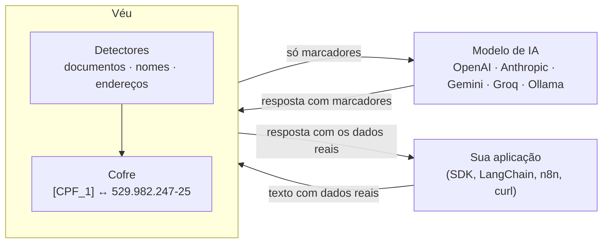
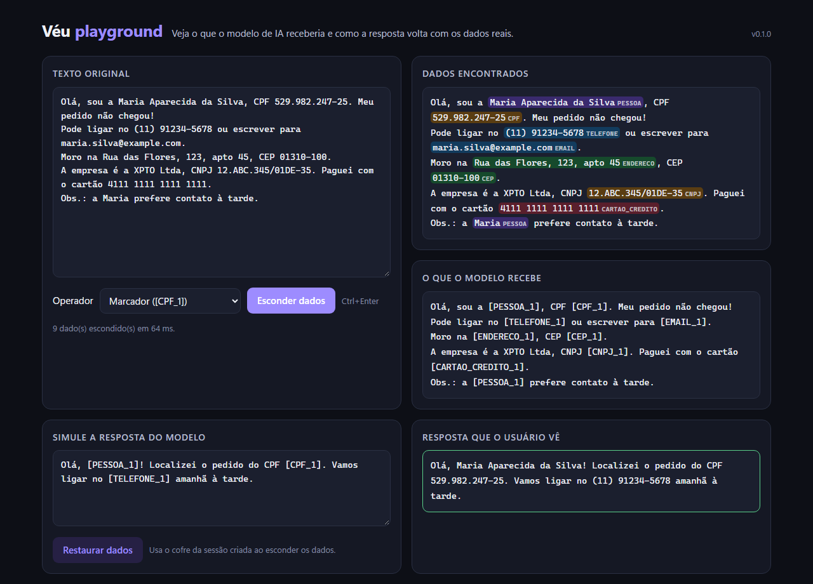

<p align="center">
  
</p>

<p align="center">
  <a href="https://github.com/guhttps/veu/actions/workflows/ci.yml"></a>
  
  
  <a href="LICENSE"></a>
</p>

# Véu

**O Véu esconde dados pessoais brasileiros antes de um texto chegar a um modelo de IA e devolve os dados reais na resposta.** A IA trabalha com `[PESSOA_1]` e `[CPF_1]`. Quem usa o sistema vê "Maria Souza" e "529.982.247-25".

Empresas brasileiras estão colocando IA no atendimento, na análise de contratos, no RH e no prontuário. Junto com cada pergunta vão CPF, nome, telefone e endereço de clientes para OpenAI, Anthropic e Google. O Véu fica no meio do caminho: entende os documentos brasileiros de verdade (valida dígitos verificadores, inclusive do **CNPJ alfanumérico** de 2026), funciona com respostas em streaming e se encaixa no que você já usa, com uma linha de configuração.

```text
Você envia     Sou a Maria Souza, CPF 529.982.247-25. Meu pedido atrasou.
A IA recebe    Sou a [PESSOA_1], CPF [CPF_1]. Meu pedido atrasou.
A IA responde  Olá, [PESSOA_1]! Localizei o pedido do CPF [CPF_1].
Você recebe    Olá, Maria Souza! Localizei o pedido do CPF 529.982.247-25.
```

> [!IMPORTANT]
> Nenhuma detecção automática é perfeita. O Véu **reduz** muito o risco de enviar dados pessoais, mas não o elimina. Veja os [números do benchmark](#benchmark) e as [limitações](SECURITY.md#o-que-o-véu-não-faz). Não é aconselhamento jurídico sobre a LGPD.

## Recursos

- 🇧🇷 **21 tipos de dados brasileiros:** CPF, CNPJ (numérico e alfanumérico), RG, CNH, título de eleitor, PIS/NIT, cartão do SUS, passaporte, telefone, e-mail, endereço, CEP, placa (antiga e Mercosul), RENAVAM, cartão de crédito, conta bancária, chave Pix, data de nascimento, IP, número de processo do CNJ e nomes de pessoas.
- ✅ **Validação de verdade:** dígitos verificadores de CPF, CNPJ, PIS, CNS, CNH, título, RENAVAM, processo CNJ e Luhn, além de DDDs válidos. Um número qualquer de 11 dígitos não vira CPF.
- 🧠 **Nomes sem modelo de IA:** listas de nomes brasileiros, capitalização e contexto ("Sr.", "cliente", "oi joão"), sem confundir "Banco do Brasil", "Rua Augusta" ou "São José dos Campos". Opcionalmente, spaCy ou um modelo local (Ollama).
- 🔁 **Reversível e consistente:** o mesmo dado recebe sempre o mesmo marcador, "João" sozinho é ligado a "João da Silva", e a restauração tolera o que os modelos fazem com os marcadores (`[CPF 1]`, `CPF_1`, `[cpf_1`).
- 🌊 **Streaming de verdade:** marcadores que chegam partidos entre pedaços ("[PES" + "SOA_1]") são remontados, inclusive dentro dos argumentos JSON de chamadas de ferramentas.
- 🎭 **5 operadores:** marcador, valor sintético (outro CPF válido, outro nome), máscara (`***.982.247-**`), remoção e hash estável.
- 🔌 **Várias integrações:** proxy para OpenAI, Anthropic e Gemini (e qualquer API compatível com OpenAI), transporte para os SDKs Python, API REST, filtro de logs, hook de pre-commit, CLI e Docker.
- 🛡️ **Política e auditoria:** bloqueie tipos de dados (como cartões), mantenha uma lista de valores permitidos e registre um log de auditoria só com contagens, nunca com os valores.
- 🪶 **Leve:** o núcleo não tem dependências e processa cerca de 370 mil caracteres por segundo.

## Como funciona



O cofre com o mapeamento entre marcadores e dados reais fica só na memória do Véu e nunca é enviado ao modelo. Uma instrução curta avisa o modelo para repetir os marcadores sem tentar adivinhar os valores.

## Instalação

```bash
pip install "veu[servidor] @ git+https://github.com/guhttps/veu"
```

- Só a biblioteca, sem dependências: `pip install "veu @ git+https://github.com/guhttps/veu"`.
- Com o detector de nomes do spaCy: adicione o extra `spacy` e rode `python -m spacy download pt_core_news_lg`.
- Docker: `docker build -t veu .` e `docker run -p 8787:8787 -e VEU_TOKEN=um-segredo veu` (o token é obrigatório fora do localhost).

## Uso rápido

### 1. Como proxy (qualquer linguagem, uma linha muda)

```bash
veu servir            # http://127.0.0.1:8787, com playground em /veu/playground
```

Aponte o SDK para o Véu. A chave de API continua sendo a sua e passa direto para o provedor:

```python
from openai import OpenAI

client = OpenAI(base_url="http://127.0.0.1:8787/v1")            # OpenAI
groq = OpenAI(base_url="http://127.0.0.1:8787/groq/v1")         # Groq, OpenRouter, Ollama, Maritaca...

resposta = client.chat.completions.create(
    model="gpt-4o-mini",
    messages=[{"role": "user", "content": "Sou a Maria Souza, CPF 529.982.247-25. Meu pedido atrasou."}],
)
print(resposta.choices[0].message.content)   # a IA viu [PESSOA_1] e [CPF_1]; você vê os dados reais
```

### 2. Dentro do seu código Python, sem proxy

```python
from veu.integrations.sdk import openai_client, anthropic_client

client = openai_client()         # igual a openai.OpenAI(...), mas protegido pelo Véu
claude = anthropic_client()      # igual a anthropic.Anthropic(...)
```

### 3. Como biblioteca

```python
import veu

resultado = veu.anonymize("Oi, sou o João da Silva, CPF 529.982.247-25, tel (11) 91234-5678.")
resultado.text
# 'Oi, sou o [PESSOA_1], CPF [CPF_1], tel [TELEFONE_1].'

veu.restore("Certo, [PESSOA_1]. Vou ligar no [TELEFONE_1].", resultado.vault)
# 'Certo, João da Silva. Vou ligar no (11) 91234-5678.'
```

## Integrações

| Onde | Como | Guia |
|---|---|---|
| OpenAI (Python, Node, qualquer linguagem) | Proxy em `/v1` ou `openai_client()` | [OpenAI](docs/integracoes.md#openai) |
| Anthropic (Claude) | Proxy em `/v1/messages` ou `anthropic_client()` | [Anthropic](docs/integracoes.md#anthropic) |
| Google Gemini | Proxy em `/v1beta/...` (API nativa) ou `/gemini-openai/v1` | [Gemini](docs/integracoes.md#gemini) |
| Groq, OpenRouter, DeepSeek, Mistral, Together, Maritaca, Ollama, LM Studio | Prefixo no proxy: `/groq/v1`, `/ollama/v1`... | [Provedores](docs/integracoes.md#provedores-compatíveis-com-openai) |
| LangChain e LlamaIndex | `base_url` apontando para o proxy | [LangChain](docs/integracoes.md#langchain) |
| n8n, Make, Zapier e outras linguagens | API REST: `/veu/v1/anonimizar` e `/veu/v1/restaurar` | [API REST](docs/integracoes.md#api-rest-n8n-make-qualquer-linguagem) |
| Logs da sua aplicação | `protect_logs()` esconde dados pessoais do `logging` | [Logs](docs/integracoes.md#logs) |
| Repositórios Git | Hook de pre-commit que barra commits com CPF, e-mails... | [pre-commit](docs/integracoes.md#pre-commit-e-ci) |
| Arquivos e scripts | CLI: `veu detectar`, `anonimizar`, `restaurar` | [CLI](docs/integracoes.md#linha-de-comando) |

O proxy cobre Chat Completions, Responses, Embeddings e Completions da OpenAI, Messages da Anthropic e generateContent, streamGenerateContent, countTokens e embedContent do Gemini, com e sem streaming. Por segurança, requisições `POST` para endpoints que ele não sabe proteger (como upload de áudio) são **bloqueadas**, e não repassadas sem proteção.

## Playground

Abra `http://127.0.0.1:8787/veu/playground` para ver o que a IA receberia e testar a restauração:

<p align="center"></p>

## O que é detectado

| Tipo | Exemplo | Como |
|---|---|---|
| `PESSOA` | Maria Aparecida da Silva, "oi joão" | listas de nomes, capitalização e contexto |
| `CPF` | 529.982.247-25 | formato + dígitos verificadores |
| `CNPJ` | 11.222.333/0001-81, 12.ABC.345/01DE-35 | numérico e alfanumérico + dígitos |
| `TELEFONE` | (11) 91234-5678, +55 21 3456-7890 | DDD válido, celular com 9 |
| `EMAIL` | maria@empresa.example | formato |
| `ENDERECO` | Rua das Flores, 123, apto 45 | logradouro + nome + número/complemento |
| `CEP` | 01310-100 | formato (8 dígitos soltos só com contexto) |
| `RG` | 12.345.678-9 | formato e contexto |
| `CNH`, `TITULO_ELEITOR`, `PIS`, `RENAVAM` | — | contexto + dígitos verificadores |
| `CNS` | 898 0010 0123 4567 | dígitos verificadores do cartão do SUS |
| `PASSAPORTE` | AB123456 | contexto |
| `PLACA` | ABC-1234, BRA2E19 | padrão antigo e Mercosul |
| `CARTAO_CREDITO` | 4111 1111 1111 1111 | Luhn + bandeira |
| `CONTA_BANCARIA` | agência 1234, conta 12345-6 | contexto |
| `CHAVE_PIX` | chave aleatória (UUID) | contexto ("pix", "chave") |
| `DATA_NASCIMENTO` | nascida em 12/03/1990 | contexto (datas comuns não são escondidas) |
| `IP` | 200.147.67.142, 2804:14c::1 | IPv4 e IPv6 válidos |
| `PROCESSO` | 0710802-55.2019.8.07.0001 | numeração única do CNJ + dígitos |

Também dá para adicionar padrões próprios (matrícula, número de cliente...) no [`veu.toml`](examples/veu.toml).

## Operadores

| Operador | Resultado | Reversível |
|---|---|---|
| `token` (padrão) | `[CPF_1]` | sim |
| `sintetico` | `686.192.633-74` (outro CPF válido), "Gilson Bueno" | sim |
| `mascara` | `***.982.247-**` | não |
| `remover` | `[CPF]` | não |
| `hash` | `[CPF_3fa2c1d9]`, estável entre requisições com o mesmo `VEU_SEGREDO` | sim, com o cofre |

O modo sintético costuma dar respostas melhores em tarefas que dependem do formato (validar um CPF, formatar um telefone), porque o modelo vê valores realistas.

## Benchmark

O Véu vem com um gerador de textos realistas (atendimento, saúde, jurídico, RH, conversas de WhatsApp, formulários) com dados **falsos** e anotados, e um conjunto de casos difíceis escritos à mão. A métrica principal é o **vazamento**: a fração dos dados pessoais que chegaria ao modelo sem estar totalmente escondida.

```bash
veu avaliar --quantidade 1000
```

| Conjunto | Textos | Precisão | Revocação | Vazamento geral | Vazamento de nomes |
|---|---:|---:|---:|---:|---:|
| Validação (modelos de texto **não usados** para ajustar o detector) | 1.000 | 100,0% | 97,5% | **2,5%** | 6,5% |
| Validação, com o detector spaCy ligado | 1.000 | 97,8% | 98,6% | **1,2%** | 3,0% |
| Casos difíceis escritos à mão | 25 | 100,0% | 100,0% | 0,0% | 0,0% |
| Desenvolvimento (modelos usados no ajuste) | 1.000 | 100,0% | 100,0% | 0,0% | 0,0% |

Como ler esses números com honestidade:

- **O número que importa é o da validação.** O conjunto de desenvolvimento chega a 100% porque o detector foi ajustado olhando para ele.
- **Documentos com dígitos verificadores** (CPF, CNPJ, cartão, processo...) ficaram em 0% de vazamento nos três conjuntos. **Nomes são a parte difícil**, principalmente em minúsculas, em conversas sem saudação ("kkkk o rayane esqueceu").
- **O spaCy reduz o vazamento de nomes para menos da metade, mas é cerca de 18 vezes mais lento** (20 mil contra 370 mil caracteres por segundo) e traz alguns falsos positivos. Sozinho, sem as regras do Véu, o spaCy deixou passar 10% dos nomes.
- **Os textos são sintéticos.** Em dados reais, espere resultados piores. Teste com uma amostra dos seus próprios textos antes de confiar.

Detalhes da metodologia em [docs/benchmark.md](docs/benchmark.md).

## Configuração

Tudo funciona sem configuração. Para ajustar, crie um `veu.toml` (exemplo completo em [examples/veu.toml](examples/veu.toml)):

```toml
[deteccao]
limiar = 0.5                                   # 0 a 1; mais alto = menos falsos positivos
ignorar = ["contato@minhaempresa.example"]      # valores que nunca são escondidos

[anonimizacao]
operador = "token"

[politica]
bloquear = ["CARTAO_CREDITO"]                  # recusa a requisição em vez de só esconder

[servidor]
log_auditoria = "veu-auditoria.jsonl"          # só contagens, nunca os valores
```

As principais opções também aceitam variáveis de ambiente: `VEU_LIMIAR`, `VEU_OPERADOR`, `VEU_BLOQUEAR`, `VEU_HOST`, `VEU_PORTA`, `VEU_TOKEN`, `VEU_PERMITIR_SEM_TOKEN`, `VEU_LIMITE_CORPO_MB`, `VEU_SEGREDO`, `VEU_PROVEDOR_PADRAO` e `VEU_URL_<PROVEDOR>`.

## Segurança

- O Véu ouve só em `127.0.0.1` por padrão e, assim, recusa requisições de outros sites abertos no navegador (CSRF e DNS rebinding).
- Fora do localhost (Docker, servidor), ele **não inicia sem `VEU_TOKEN`**: todas as rotas passam a exigir o cabeçalho `X-Veu-Token`.
- As chaves de API vêm do cliente e passam direto para o provedor. Injetar chaves do servidor (`injetar_chaves = true`) é opcional.
- O cofre fica na memória e expira em uma hora sem uso. Sessões de credenciais diferentes nunca compartilham o cofre.
- O Véu protege os dados do provedor de IA, mas não decide quem pode ver o quê dentro da sua aplicação: veja as [limitações](SECURITY.md#o-que-o-véu-não-faz).

Leia o [modelo de ameaças e as limitações](SECURITY.md) antes de usar em produção.

## Desenvolvimento

```bash
git clone https://github.com/guhttps/veu && cd veu
python -m venv .venv && .venv/Scripts/activate      # Linux/macOS: source .venv/bin/activate
pip install -e ".[dev]"
pytest                    # mais de 130 testes, inclusive com os SDKs oficiais da OpenAI e da Anthropic
ruff check .
veu avaliar               # benchmark
```

Veja o [guia de contribuição](CONTRIBUTING.md). Contribuições de nomes, padrões de documentos e casos difíceis são muito bem-vindas.

## Próximos passos

- [ ] Publicar no PyPI (`pip install veu`)
- [ ] Mais casos difíceis escritos à mão, de domínios reais (com dados fictícios)
- [ ] Detector de nomes em minúsculas sem saudação ("o rayane esqueceu")
- [ ] Imagem Docker publicada no GitHub Container Registry
- [ ] Suporte à API Realtime e a uploads de arquivos

## Licença

[MIT](LICENSE). Os dados usados nos exemplos e no benchmark são fictícios.
